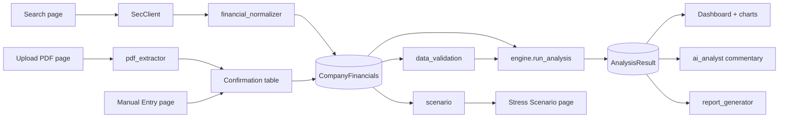

# Architecture

Everything flows through one shared data model, `CompanyFinancials` (`src/models.py`). Whatever the source, data is converted into this model, validated, confirmed by the analyst where needed, and only then analysed.

## Data flow

Text version:

1. **SEC route:** Search -> `SecClient` -> `normalize_company_facts` -> `CompanyFinancials`.
2. **PDF / manual route:** `pdf_extractor` or manual form -> editable confirmation table -> `CompanyFinancials` (values marked `USER_CONFIRMED`).
3. **Analysis:** `CompanyFinancials` -> `run_analysis` (validation + ratios + score + alerts) -> `AnalysisResult`.
4. **Output:** `AnalysisResult` -> dashboard, charts, commentary and downloadable report. `CompanyFinancials` -> `run_scenario` -> stress scenario page.

Pages never call each other directly. They share data only through `src/state.py` (`set_financials`, `get_financials`, `go_to`, ...).

## Key design rules

- Missing value = `None`, never `0`.
- Money is stored in full currency units; currencies are never converted.
- Each figure carries `Provenance` (source, location, original text, tag, verification status).
- If data is insufficient the score is `None` with an explanation; weights are never redistributed.
- **Coverage with missing interest expense** (decision 2026-11-27, see below):
  - *Zero debt is not missing data.* If short-term and long-term debt are both reported (not `None`) and sum to 0,
    and interest expense is missing or 0, coverage gets full points with the explanation "No reported debt, so no
    interest burden."
  - *Missing interest with debt is not zero interest.* If debt is above 0 (or missing) and interest expense is
    missing, coverage is "not scorable" (`points = None`). It is never treated as 0 interest.
  - *Partial score.* When coverage is the only factor that cannot be scored, the four other factors are still shown
    as "Partial score: X of 80 available points". `total` stays `None` and no risk band is given. The 80 points are
    never scaled up to 100.
  - Two or more factors not scorable → "Insufficient Data — Full Credit Score Unavailable", as before.
  - The SEC normalizer first tries alternative interest tags (and cash paid for interest) before giving up.

## Decision log

| Date | Decision | Why | Who changes what |
|---|---|---|---|
| 2026-11-27 | Coverage rule above: zero debt scores full coverage; missing interest expense makes coverage "not scorable" with a partial score out of 80 and no band; no weight redistribution. | Real SEC data: Apple has no interest expense tag, so its whole score was "Insufficient Data"; the zero-debt case was wrongly blocked too. | P1: this doc and acceptance tests A5.3, A5.6, A5.7. P4: `credit_scoring.py` (and dashboard text with P5). P2: fallback interest tags in `financial_normalizer.py`. |
- Tests run offline; live-network tests are marked `live` and skipped by default.

## Module ownership

| Module | Owner |
|---|---|
| `app.py`, `src/models.py`, `src/config.py`, `src/state.py`, `src/data_validation.py`, `src/ui/theme.py`, `tests/fixtures/sample_data.py` | Person 1 |
| `src/sec_client.py`, `src/company_search.py`, `src/financial_normalizer.py`, `src/public_data.py`, `src/ui/search_page.py`, `scripts/reconcile.py` | Person 2 |
| `src/pdf_extractor.py`, `src/manual_input.py`, `src/ui/upload_page.py`, `src/ui/manual_page.py`, `src/ui/confirm_table.py` | Person 3 |
| `src/financial_calculations.py`, `src/credit_scoring.py`, `src/risk_alerts.py`, `src/engine.py`, `src/scenario.py`, `src/ui/scenario_page.py` | Person 4 |
| `src/charts.py`, `src/ai_analyst.py`, `src/report_generator.py`, `src/ui/dashboard_page.py`, `src/ui/methodology_page.py` | Person 5 |
