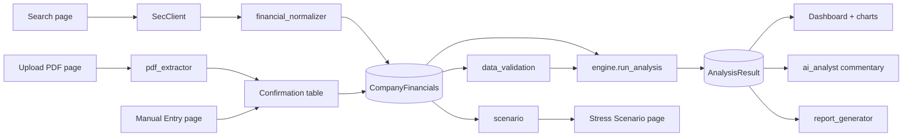

# Architecture

Everything flows through one shared data model, `CompanyFinancials` (`src/models.py`). Whatever the source, data is converted into this model, validated, confirmed by the analyst where needed, and only then analysed.

## Data flow

Text version:

1. **SEC route:** Search -> `SecClient` -> `normalize_company_facts` -> `CompanyFinancials`.
2. **PDF / manual route:** `pdf_extractor` or manual form -> editable confirmation table -> `CompanyFinancials` (values marked `USER_CONFIRMED`).
3. **Analysis:** `CompanyFinancials` -> `run_analysis` (validation + ratios + score + alerts) -> `AnalysisResult`.
4. **Output:** `AnalysisResult` -> dashboard, charts, commentary and downloadable report. `CompanyFinancials` -> `run_scenario` -> stress scenario page.

Pages never call each other directly. They share data only through `src/state.py` (`set_financials`, `get_financials`, `go_to`, ...).

## Key design rules

- Missing value = `None`, never `0`.
- Money is stored in full currency units; currencies are never converted.
- Each figure carries `Provenance` (source, location, original text, tag, verification status).
- If data is insufficient the score is `None` with an explanation; weights are never redistributed.
- Tests run offline; live-network tests are marked `live` and skipped by default.

## Module ownership

| Module | Owner |
|---|---|
| `app.py`, `src/models.py`, `src/config.py`, `src/state.py`, `src/data_validation.py`, `src/ui/theme.py`, `tests/fixtures/sample_data.py` | Person 1 |
| `src/sec_client.py`, `src/company_search.py`, `src/financial_normalizer.py`, `src/public_data.py`, `src/ui/search_page.py`, `scripts/reconcile.py` | Person 2 |
| `src/pdf_extractor.py`, `src/manual_input.py`, `src/ui/upload_page.py`, `src/ui/manual_page.py`, `src/ui/confirm_table.py` | Person 3 |
| `src/financial_calculations.py`, `src/credit_scoring.py`, `src/risk_alerts.py`, `src/engine.py`, `src/scenario.py`, `src/ui/scenario_page.py` | Person 4 |
| `src/charts.py`, `src/ai_analyst.py`, `src/report_generator.py`, `src/ui/dashboard_page.py`, `src/ui/methodology_page.py` | Person 5 |
