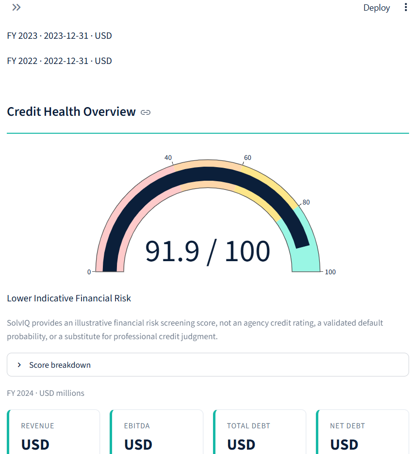
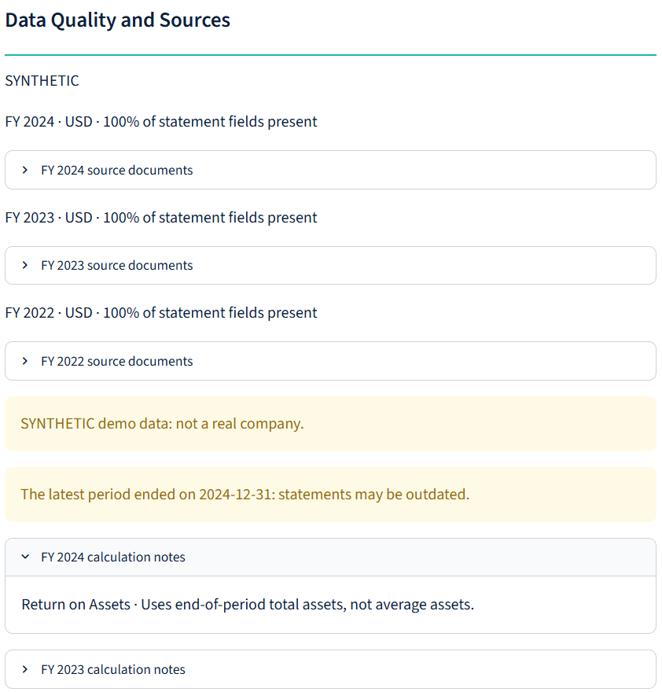

# SolvIQ | Business plan
## 1. Executive brief
**Audience:** Sponsoring executive or early-stage investor

**Product:** Preliminary corporate credit screening

**Decision requested:** Sponsor a controlled pilot with a corporate credit team.

SolvIQ is designed to give an analyst a structured first pass on a non-financial company. The workflow brings confirmed financial statements, deterministic credit indicators, provenance, a preliminary narrative and a portable report into a single review. The analyst remains accountable for verifying the evidence and deciding what requires escalation.

The initial use case is a screening analyst comparing recent annual periods before deciding whether a case warrants deeper diligence. The team should begin with a small workflow, with public filings as the easiest source to reproduce and confirmed PDF or manual inputs as fallback routes. The sponsor should judge this pilot on traceability, data handling and analyst adoption before considering procurement or any wider use.

**Current product status.** SolvIQ now integrates public SEC financial data, PDF and manual input workflows, deterministic financial analysis, credit scoring, risk alerts, stress scenarios, an interactive dashboard and a downloadable HTML report. On the Person 5 review-fixes branch, 518 automated tests passed with zero failures, and the SYNTHETIC demonstration company displayed a verified screening score of 91.875/100. The public-data owner reported 20/20 matching reconciliation figures against official Microsoft and Apple 10-K filings. Financial commentary remains deterministic and rule-based; LLM integration has been designed but is not enabled. No customer adoption, measured time savings or commercial outcomes are claimed.

**Pilot deliverables:** a comparable baseline case, a timed screening exercise, a reconciliation checklist and a decision on whether the prototype meets documented acceptance criteria.

---

## 2. Problem and evidence to collect
A first-pass screen asks whether the available statements support further investigation. A typical analyst may move between filings, worksheets and a memo template. Each handoff creates opportunities to lose the reporting period, apply the wrong units or carry forward a number after a corrected filing. A reviewer may then need to repeat the analyst's work to locate the source.

| Workflow point | Example failure | Consequence |
| --- | --- | --- |
| Identify entity | Similar issuer names or parent/subsidiary confusion | Figures describe the wrong borrower |
| Collect annual figures | Fiscal periods or reporting units are mixed | Apparent growth or leverage is misleading |
| Draft a memo | Spreadsheet blanks become zeroes | Unsupported conclusions appear checkable |
| Review | Source reference is omitted | The reviewer repeats extraction work |

This is a product hypothesis, grounded in the sequence of tasks and the risks above. Validate it through interviews and paired work samples. Ask each participant to prepare the same case using their current process and the prototype. Record time to first reviewable report, fields corrected, sources checked and unresolved exceptions. Use public or approved synthetic cases. Report sample size, median, spread and the reasons for any exclusions. Treat any time savings as pilot observations rather than market-wide forecasts.

The sponsor should first assess whether fewer steps are needed to reproduce a reported number, whether the same statement period reaches the dashboard and the memo, and whether reviewers can identify why a ratio is unavailable.

---

## 3. Product and evidence
The intended flow is company confirmation, statement confirmation where needed, common financial model, deterministic analysis, dashboard and HTML report. The output shows annual periods, financial ratios, directional trends, alerts and preliminary commentary. A reviewer can inspect ratio formulas and inputs, open the provenance section and print the report.

| Interaction | Control |
| --- | --- |
| Public collection | Confirm issuer identity and record filing references where available |
| PDF or manual entry | Analyst reviews and confirms statement inputs |
| Calculation | Use engine outputs and expose unavailable or undefined ratios |
| Interpretation | Show the observation, interpretation and missing evidence separately |
| Reporting | Include data sources, limitations, and the screening disclaimer |

The following screenshots demonstrate the integrated SolvIQ prototype using synthetic financial data.

*Figure 1. Synthetic company screening score of 91.9/100.*

*Figure 2. Statement completeness, source document access and data freshness warnings for FY2022-FY2024.*

Current scopes include annual non-financial corporate analysis and no currency conversion. The integrated prototype supports synthetic demonstration data and analyst-confirmed financial inputs. These technical results do not establish predictive accuracy or commercial validation. The product accepts no credit decision and makes no probability-of-default claim.

---

## 4. Users, market and positioning
**Primary user:** a corporate credit analyst doing recurring first-pass screens.

**Workflow owner:** head of underwriting or credit operations.

**Buyer:** a risk executive or product sponsor with a budget for analyst tooling.

**Reviewers:** credit risk, information security and a data governance representative.

| Segment | Use case | Buying constraint |
| --- | --- | --- |
| Smaller commercial lenders | Standardise a first-pass memo and escalation | Implementation effort and data privacy |
| Specialist corporate lenders | Group statements and checks across incoming deals | PDF variability and sector-specific interpretation |
| Larger banks or advisory teams | Internal comparison or training pilot | Procurement, security review and model governance |

Initial targeting should focus on a desk willing to evaluate matched cases with a named sponsor and a review owner. The prototype competes for workflow time against internal Excel templates and manually assembled memos, bank-owned underwriting systems and market data platforms. Spreadsheets are flexible and familiar. Data platforms provide broad coverage. SolvIQ's proposed position is a traceable, bounded screen that can be inspected with public or analyst-confirmed inputs. This positioning is a hypothesis pending user interviews.

Market opportunity: The FDIC Quarterly Banking Profile reported 4,205 insured US banking institutions in Q3 2026 (https://alfred.stlouisfed.org/release?rd=2026-11-24&rid=482). This provides a broad market reference, not a validated addressable market. Assuming an initial target segment of 200 eligible institutions, five analyst seats per institution and a hypothetical subscription of USD 99 per seat per month, the illustrative annual revenue opportunity is USD 1,188,000. Acquiring 20 institutions would represent USD 118,800 in annual recurring revenue. Eligibility, adoption and willingness to pay remain unvalidated assumptions. No existing customers or commercial traction are claimed.

---

## 5. Organisational transformation (LO5)
| Role | Current work pattern | Proposed pilot pattern |
| --- | --- | --- |
| Analyst | Gather, transcribe and format first-pass figures | Confirm entity and inputs, inspect exceptions and draft a review note |
| Reviewer | Recreate ratios and search for source figures | Follow provenance and verify selected material inputs against the source |
| Credit policy owner | Reconcile inconsistent interpretations | Set approved uses and define escalation and override handling |
| Operations owner | Manage spreadsheet or template changes | Track sources, acceptance criteria and versioned releases |

The desirable future state keeps time for judgment and makes traceability a repeatable part of the screening process. The analyst confirms input quality and context, the reviewer samples evidence and the policy owner defines when the workflow must stop or escalate. Cases with unsupported ratios should carry the gap forward into the review record.

Pilot change management should include an onboarding case, examples of unavailable ratios, a correction workflow and feedback from reviewers before wider use. A failed reconciliation or unsupported company type triggers a hand-off to the team's existing review process. An audit trail for corrections and reviewer actions is a roadmap item.

Success metrics include time to a reviewable screen, number of material figures traceable without escalation, correction rate and the proportion of cases where the analyst records a meaningful unresolved question.

---

## 6. Systems view and controls (LO6)
Information passes from the filer or borrower to the data collection process, then to the analyst, reviewer and possibly a credit committee. Source integrity, access and accountability matter at each boundary.

| Failure mode | Control or release gate | Owner |
| --- | --- | --- |
| Wrong entity, fiscal period or reporting unit | Entity confirmation and sample reconciliation to filings | Analyst and data owner |
| Incomplete or stale input | Label unavailable values and show validation warnings | Analyst and engine owner |
| Ambiguous PDF extraction | Confirm the selected values and retain source references where supplied | Analyst |
| Unavailable or unstable public feed | Distinguish outage from unavailable coverage and offer approved fallback | Data owner |
| Overreliance on a screening score | Display the disclaimer, factors and gaps. Escalate to a professional reviewer | Credit policy owner |
| Private data transmitted to an AI service | Local rule-based commentary in this release | Product and security owners |
| User-provided content in an export | Escape dynamic text and test HTML contexts | Product owner |

The report captures a screening view. Reviewers should still interrogate cash-flow resilience, debt maturities, qualitative risks and any limitations in the source data. The organisation should define retention, access and review responsibility before a private-data pilot. A release gate should require a checked reference case, versioned methodology, reviewed test results and a documented error process.

---

## 7. SDG 9 contribution
SolvIQ relates most closely to the infrastructure and innovation themes of UN Sustainable Development Goal 9. Target 9.3 concerns access to financial services and markets for small-scale enterprises. A screening tool's role is indirect. The rationale is that a smaller credit team can inspect and reproduce a first-pass analysis using structured public data and locally processed confirmed inputs.

Transparency comes from period and currency labels, visible formulas, provenance where available, and explicit missing values. A local commentary path supports responsible use by reducing dependence on a third-party provider and carrying input gaps into the output. A printable report helps a reviewer reproduce the reasoning even if they work outside the app.

Potential pilot measures are analyst onboarding time, proportion of supported cases with traceable core figures and proportion of unavailable ratios correctly disclosed. These measures relate to analytical accessibility and reliability. They do not measure changes in lending access or outcomes.

Coverage of annual public filings is limited to the supported universe. Private-company coverage depends on the availability and quality of statements. Smaller lenders may still face access, integration, staffing and governance constraints. No environmental benefit or improvement in funding outcomes has been demonstrated.

**Source:** United Nations Department of Economic and Social Affairs, Goal 9. https://sdgs.un.org/goals/goal9

---

## 8. Business model and roadmap
SolvIQ proposes a B2B SaaS subscription model. The Professional plan would cost USD 99 per analyst per month, while a five-seat Team plan would cost USD 495 per month (USD 5,940 annually). Enterprise pricing would be negotiated based on deployment, security, governance and support requirements. Assessment-based pricing could also be evaluated for occasional users. These proposed prices are illustrative hypotheses and must be validated through buyer interviews and pilot feedback.

| Cost driver | Basis for a future estimate |
| --- | --- |
| Infrastructure | Concurrent analysts, session memory, hosting and monitoring requirements |
| Data maintenance | Frequency of filing tag and format changes, reconciliation workload |
| Product support | Onboarding, documentation and incident handling per desk |
| Governance | Security review, permissioning, acceptance testing and audit logging |

**Go-to-market.** Start with a sponsorship-led pilot on reproducible public cases. Expand to approved private inputs only when the sponsor has established data handling and review controls. Measure whether the workflow saves reviewer effort or improves traceability. Package the evidence into a pilot close-out and decide whether to build a repeatable onboarding path.

**Roadmap.** Phase 1 - MVP: deliver the integrated financial screening workflow, including public and confirmed private inputs, deterministic scoring, stress scenarios, dashboard and report export. Phase 2 - Pilot: validate analyst adoption, measure workflow efficiency, strengthen security controls and implement an audit trail. Phase 3 - Scale: evaluate OCR, governed LLM integration, additional financial data sources, peer benchmarking and industry-specific thresholds.

**References**

- U.S. Securities and Exchange Commission. EDGAR Application Programming Interfaces. https://www.sec.gov/search-filings/edgar-application-programming-interfaces
- United Nations Department of Economic and Social Affairs. Goal 9. https://sdgs.un.org/goals/goal9
- EDHEC Business School. Programming and AI for Corporate Finance. Final project brief, 2026–2027.
